<p align="center">
  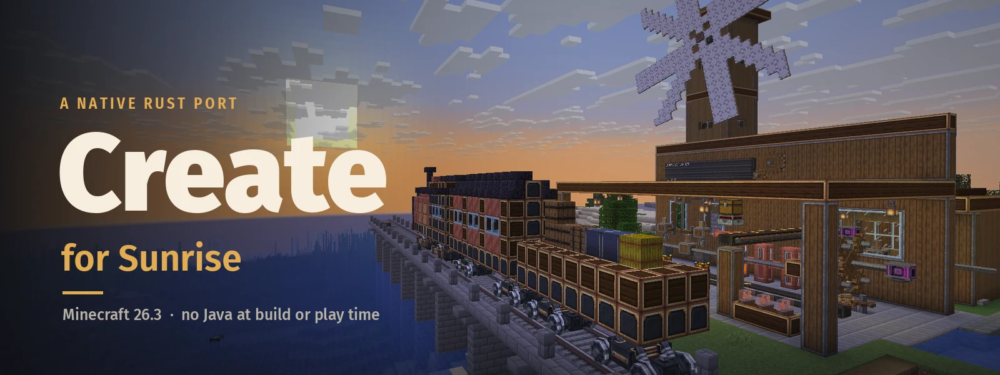
</p>

<p align="center">
  <a href="#install"><b>Install</b></a> ·
  <a href="#documentation"><b>Docs</b></a> ·
  <a href="CONTRIBUTING.md"><b>Contributing</b></a>
</p>

<p align="center">
  <a href="LICENSE"></a>
  <a href="https://modrinth.com/mod/create"></a>
  <a href="https://playsunrise.net"></a>
</p>

# Create for Sunrise

**[Create](https://github.com/Creators-of-Create/Create) 6.0.11, ported to native Rust.** A native mod for
Sunrise. No Java at build time or play time, and no mixins.

- **[Sunrise](https://playsunrise.net)** ([GitHub](https://github.com/sunrise-org/sunrise)): works now.
- **Horizon**: its mod API has shipped. The port is built and tested on Sunrise and not yet tried on Horizon.

Create is the mod by the Create Team: shafts and cogs, belts and presses, contraptions and trains. This port
brings it to Minecraft 26.3 in Rust. It is built on the game's mod SDK (`mod_api`) and nothing else.

<table>
  <tr>
    <td width="50%"></td>
    <td width="50%"></td>
  </tr>
  <tr>
    <td width="50%"></td>
    <td width="50%"></td>
  </tr>
</table>

## What works

Every subsystem of Create is ported to the mod API. Highlights:

- **Kinetics.** Shafts, cogs, gearboxes, belts, water wheels, windmills, steam engines, gauges.
- **Logistics.** Funnels, chutes, tunnels, mechanical arms, ejectors, filters, item hatches.
- **Processing.** Presses, mixers and basins, blaze burners, saws, millstones, crushing wheels, deployers, fans.
- **Fluids.** Pumps, pipes, tanks, spouts, item drains, honey and chocolate.
- **Contraptions.** Bearings, pistons, pulleys, gantries, elevators, minecart contraptions, with their actors.
- **Trains.** Tracks and girder curves, stations, schedules, signals, bogeys and train controls.
- **Packages and stock.** Packagers, frogports, postboxes, chain conveyors, stock tickers, factory gauges, shops.
- **Redstone and display.** Redstone links, smart observers, display links and boards, nixie tubes.
- **Equipment.** Wrench, goggles, backtank and diving gear, potato cannon, extendo grip, toolboxes, worldshaper.
- **Schematics.** Schematic tools, the schematic table and schematicannon.
- **Advancements.** Create's advancement tree, awarded where Create awards them.

Some things need API that the game doesn't have yet, so they are left out for now. Examples: standing on or
bumping into moving contraptions and trains, Create's own enchantments at enchanting tables, and hoppers
reaching into belts and tanks. The full list, with what would fix each one: **[API_GAPS.md](API_GAPS.md)**.

## Install

> [!NOTE]
> Create's textures, models and sounds are All Rights Reserved, so they are not in this repository. Your own
> machine downloads Create's official jar from Modrinth, where the Create Team publishes it, and checks it
> against the hash pinned here. This repository ships MIT data, asset references and the port's own assets,
> never the jar or its protected assets. Full framed glass and nonrandom windows connect using the original jar's
> sheets by reference. Local `prepare` is still needed for the other connected textures, tinted copies,
> model-derived placement ghosts and other assets not yet supplied by references.

You need:

- **The Sunrise launcher**, from [playsunrise.net/download](https://playsunrise.net/download), and a Minecraft:
  Java Edition account. Play once so the launcher has an instance.
- **Rust** ([rustup](https://rustup.rs)), for the one-time prepare step.

Then:

```sh
git clone https://github.com/OlaHulleberg/create-sunrise.git
cd create-sunrise/tools/create-data

# Assemble the mod. This downloads Create's official jar from Modrinth into your cache
# and checks its SHA-512. Offline? Add --jar /path/to/create-1.21.1-6.0.10.jar
cargo run --release -- prepare --out ../../target/create-mod/create

# Build it into your instance, then play.
cd ../..
sunrise-launcher native-build target/create-mod --instance "My Instance" --trust-native-code
sunrise-launcher play --instance "My Instance" --allow-jar-downloads
```

Or start the instance from the launcher's window: it asks before downloading Create's jar into the instance.
Native mods run with your rights, which is why the launcher asks for `--trust-native-code`.

The folder in `target/create-mod` holds files made from Create's assets. It is for your own game: don't share it.

> [!NOTE]
> The port follows Create 6.0.11's source. Its assets come from the newest published jar, 1.21.1-6.0.10
> (6.0.11 isn't released yet); the two differ in only two textures.

> The pinned nightly has an official signed SDK, fetched automatically by `cargo sunrise-mod`.

## See it running

Every capture is in game on Sunrise, with every machine running. Nothing is painted over.

<table>
  <tr>
    <td width="50%">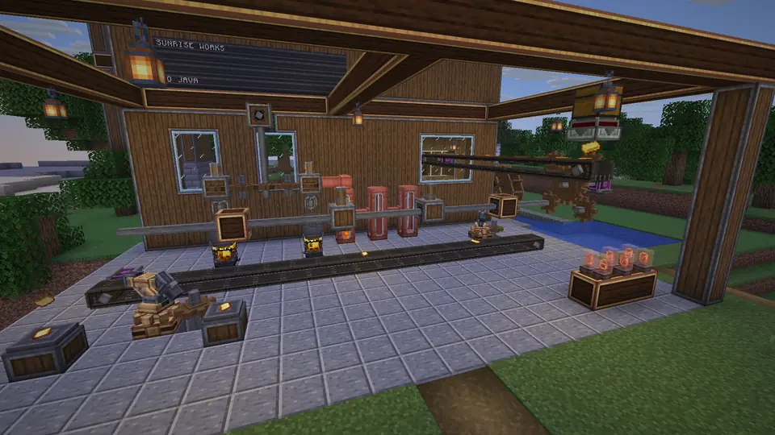<br><sub>The factory at work</sub></td>
    <td width="50%">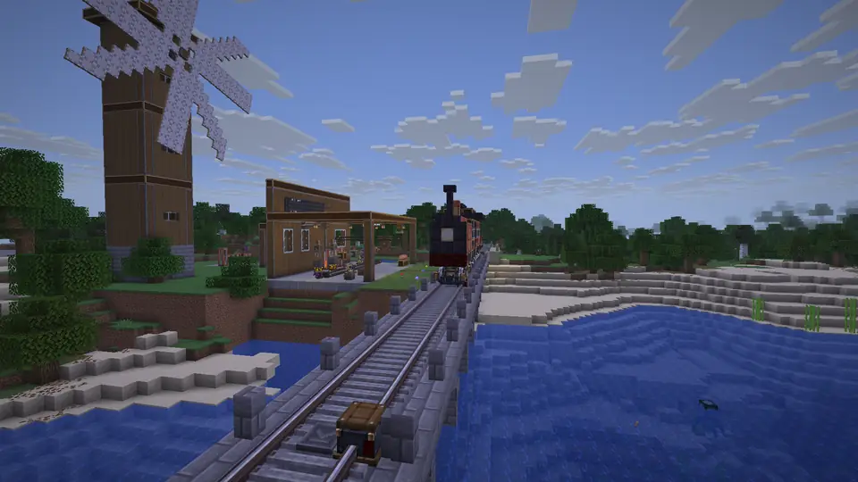<br><sub>A train on its schedule</sub></td>
  </tr>
  <tr>
    <td width="50%">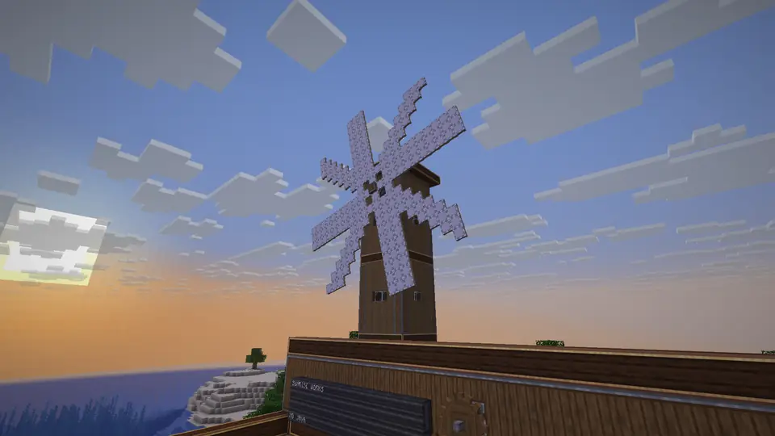<br><sub>Windmill bearing</sub></td>
    <td width="50%">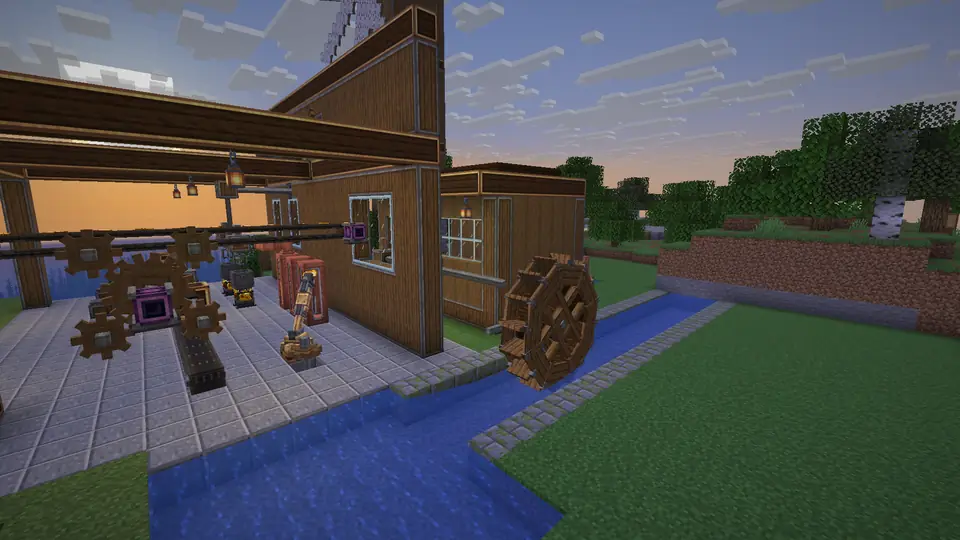<br><sub>Water wheel and gearing</sub></td>
  </tr>
</table>

<table>
  <tr>
    <td width="50%">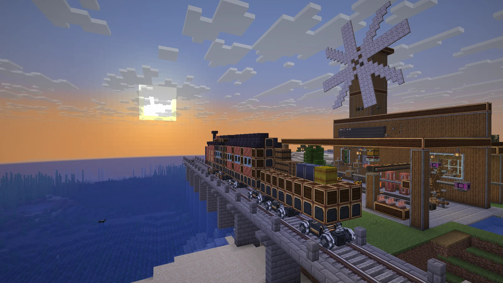</td>
    <td width="50%">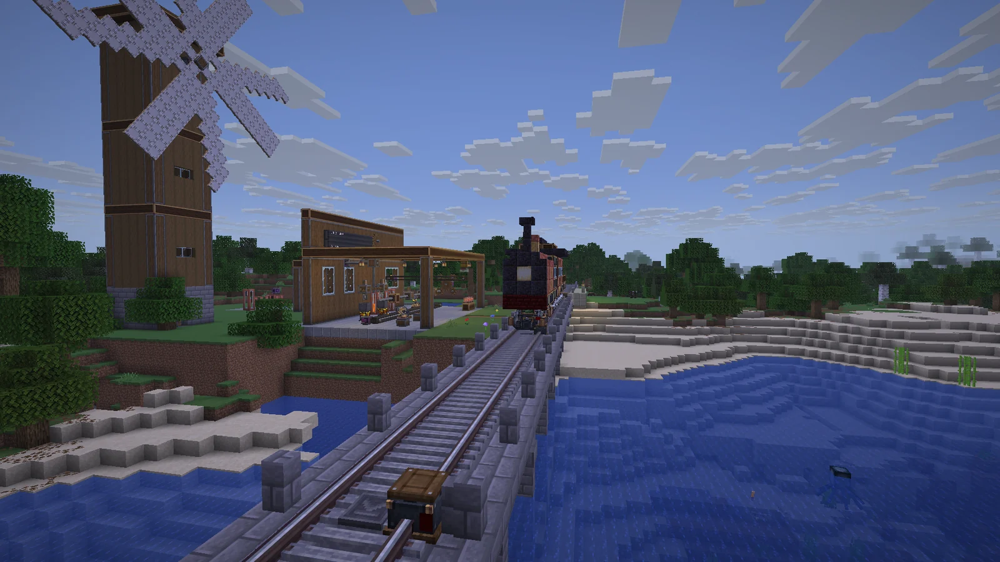</td>
  </tr>
  <tr>
    <td width="50%">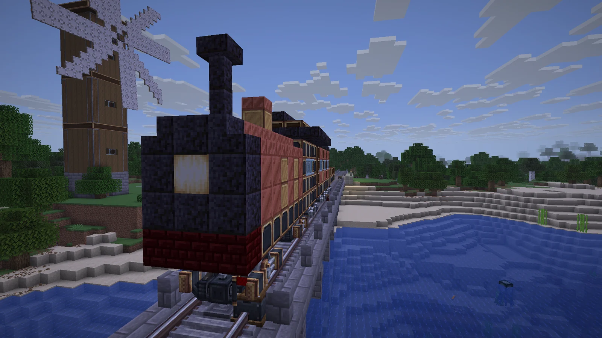</td>
    <td width="50%">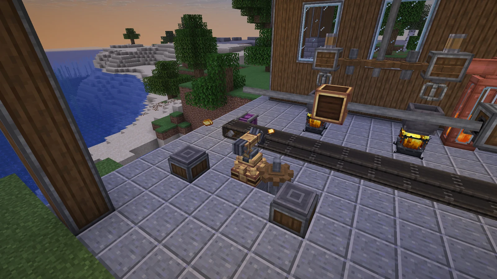</td>
  </tr>
  <tr>
    <td width="50%">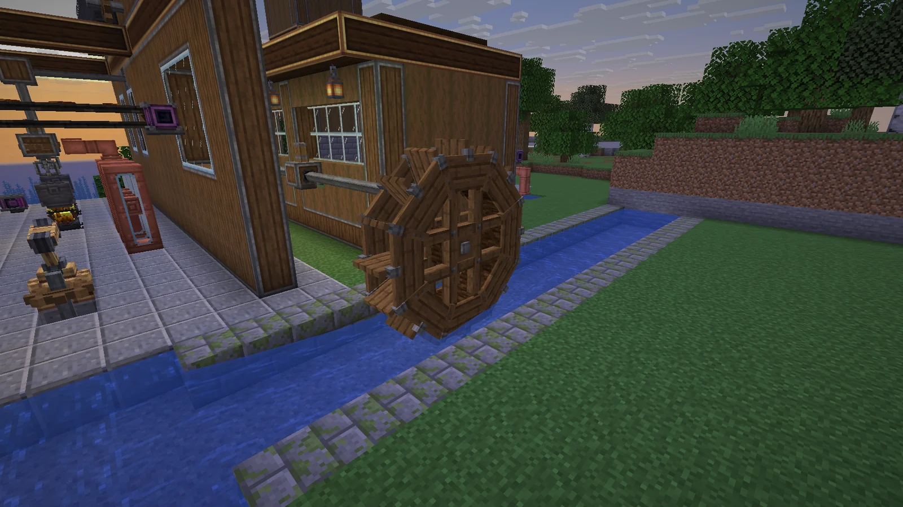</td>
    <td width="50%">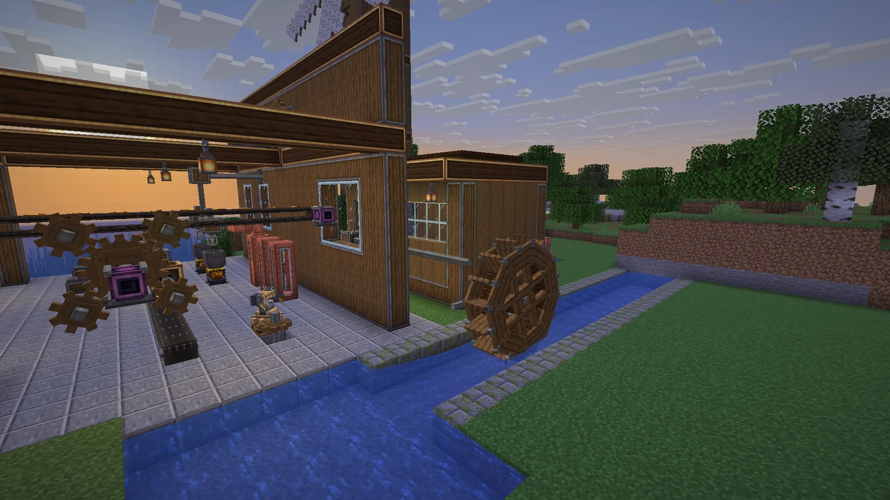</td>
  </tr>
</table>

<sub>Sunrise, Minecraft 26.3, HUD hidden. Screenshots show Create's textures and models, © the Create Team.</sub>

## Build from source

Install Rust 1.99.1 with the `wasm32-unknown-unknown` target and the signed `cargo sunrise-mod` tool from the
SDK release for `[native] sunrise` in [create/sunrise-mod.toml](create/sunrise-mod.toml). Follow Sunrise's
[tool installation guide](https://github.com/sunrise-org/sunrise/blob/94256510f74e6843754e0a93fd9e4da7e45b1056/docs/modding/src/start/install-tool.md),
setting `RELEASE=sdk-94256510f74e6843754e0a93fd9e4da7e45b1056` to install and verify that release's tool.

```sh
rustup toolchain install 1.99.1 --target wasm32-unknown-unknown
```

```sh
cd create && cargo sunrise-mod check        # fetches the pinned SDK into create/.sunrise/, then checks
```

`create-data prepare` and `native-build` (see [Install](#install)) turn the checkout into a playable mod.
After a change to Create's data, regenerate the committed tables and declarations from a Create checkout:

```sh
cd tools/create-data && cargo run -- compile --create /path/to/Create --out ../..
```

### Validation

```sh
cd create
cargo +1.99.1 fmt --check
cargo +1.99.1 clippy --all-targets -- -D warnings
cargo +1.99.1 test                      # the glue's tests
cargo +1.99.1 test -p create-engine     # the engine's tests
cargo sunrise-mod check                 # Sunrise's package rules, then cargo check for the pinned build
cd src/engine                           # the engine crate's own format and lints
cargo +1.99.1 fmt --check
cargo +1.99.1 clippy --all-targets -- -D warnings
cd ../../../tools/create-data
cargo +1.99.1 fmt --check
cargo +1.99.1 clippy --locked --all-targets -- -D warnings
cargo +1.99.1 test --locked
```

The latest results, and what was tried in game: [VALIDATION.md](VALIDATION.md).

### Layout

```text
create/                 The native mod: what the launcher builds
  sunrise-mod.toml      Identity and the pinned Sunrise build
  src/lib.rs            The one `impl Hooks`, handing each hook to every subsystem
  src/glue/             The game glue on the mod API, one module per subsystem
  src/engine/           create-engine: Create's rules as plain Rust, no game types
  data/, assets/        Generated block, item and fluid declarations
tools/create-data/      compile: tables; registry: MIT overlays and asset references; prepare: local assets
docs/                   Architecture and README media
```

## Documentation

- [docs/architecture.md](docs/architecture.md): how the mod is put together, and how to add to it.
- [API_GAPS.md](API_GAPS.md): what the mod SDK can't do yet, and what the mod leaves out because of it.
- [VALIDATION.md](VALIDATION.md): what was checked, on which build, and what was not.

## Licences

This repository is [MIT](LICENSE). It translates Create's code and compiles its data, which are MIT too.

Create's textures, models and sounds are All Rights Reserved, © the Create Team. They are not in this
repository and are never shipped from it: they come from Create's official jar. Details:
[THIRD_PARTY_NOTICES.md](THIRD_PARTY_NOTICES.md).

This is an unofficial port. Create is made by [the Create Team](https://github.com/Creators-of-Create).

## Contributing

Issues and pull requests are welcome. Read [CONTRIBUTING.md](CONTRIBUTING.md) first. In short:

- Sign off every commit (`git commit -s`, the [Developer Certificate of Origin](https://developercertificate.org)).
- Say in the pull request if AI tools helped write it.
- Never commit Create's assets.
